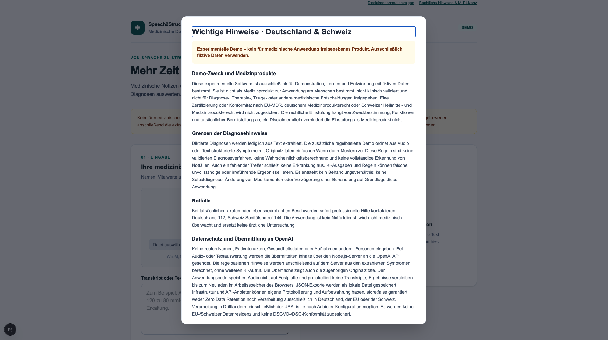
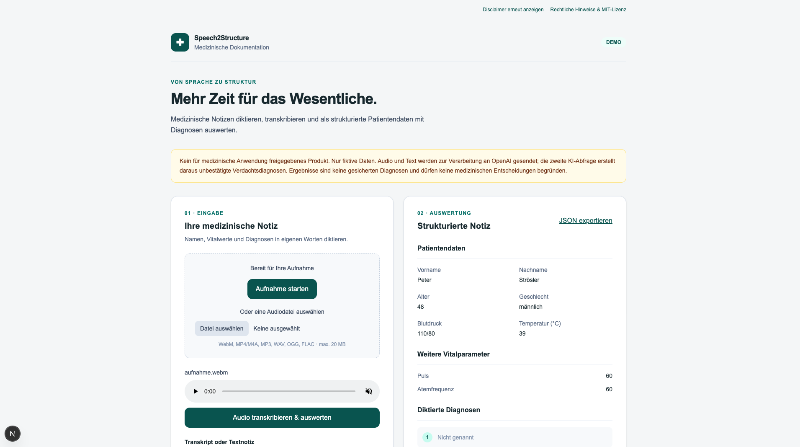

# Speech2Structure

Next.js frontend with Tailwind CSS and a Node.js backend for medical audio notes. Record audio, upload a file, or enter a transcript; receive strictly validated patient information, vital signs, dictated diagnoses and a separate AI-generated differential diagnosis.

Development demonstration with **fictional data only**. Not clinically validated or released for medical decisions. A disclaimer cannot by itself prevent classification as a medical device. See `/legal` for the DE/CH notices and the [MIT license](LICENSE).

## Screenshots





## Setup

Requires Node.js 22.12+ (or Node.js 24), npm and an OpenAI API key.

```sh
npm ci
cp .env.example .env.local
```

Set `OPENAI_API_KEY` in `.env.local`. Defaults:

```env
OPENAI_MODEL=gpt-5.4-nano
OPENAI_TRANSCRIPTION_MODEL=gpt-4o-mini-transcribe
```

`gpt-5.4-mini` is an alternative extraction/assessment model. The chosen model must support Responses API Structured Outputs. API keys are server-only and must never use a `NEXT_PUBLIC_` prefix.

```sh
npm run dev
```

Open [localhost:3000](http://localhost:3000). Recording requires HTTPS or localhost and microphone permission. Native WebM/MP4/OGG recordings and MP3/WAV/FLAC/M4A uploads are supported. Files are limited to 20 MB and transcripts to 30,000 characters.

## Processing

1. Audio is transcribed with OpenAI; text input skips this step.
2. A first model call extracts patient details, vital signs, up to five **dictated** diagnoses, explicit symptoms and additional clinical findings such as wounds, inflammation, pain and time course. Missing details remain `null` or empty lists. Findings preserve negation, uncertainty and original quotations.
3. A second model call receives the structured clinical data (without first/family names) and generates up to five **unconfirmed suspected/differential diagnoses**, explanations, supporting findings, missing information and an unvalidated urgency indication. Free clinical findings and symptoms without a nonempty quotation from the current transcript are excluded from this second request. Vital signs and dictated diagnoses are extracted values and still require review.
4. The interface shows dictated and suspected diagnoses separately and exports the full result as JSON. Editing the transcript clears the old result; use “Text auswerten” to recompute it.

The second call uses GPT-5.4 nano with low reasoning effort; extraction uses no reasoning effort. Each successful analysis therefore incurs **two text model calls**, plus transcription for audio. Names are not included in the second request, but the data is not guaranteed to be anonymized: free-text findings can still contain identifying information. The application is intended for fictional inputs only.

Fever and an inflamed wound can now be considered together, beyond the old fixed symptom list. The assessment prompt asks for serious alternatives such as possible sepsis where appropriate, without asserting a confirmed diagnosis, organ dysfunction or septic shock from insufficient data. This is prompt guidance, not a clinically validated guarantee. No probabilities, medication doses or self-treatment instructions are requested.

If the second call fails, is refused or produces invalid output, the transcript and extracted fields remain available and `aiAssessment.status` is `unavailable`. This must not be interpreted as an all-clear. The user can rerun text analysis. The legacy `ruleDiagnosis` field remains in the API for compatibility; its simple rules are no longer displayed as the primary assessment.

## Contracts and API

`GET /api` returns `{ "status": "ok" }`. `POST /api` accepts multipart `audio` or JSON:

```json
{
  "transcription": "Fiktive Notiz: Blutdruck 110/80, Temperatur 39 Grad, entzündete Wunde am Fuß."
}
```

The response includes:

- `transcription`: the text used for analysis.
- `categories`: patient details, vital signs, `diagnosis` slots `1`–`5`, `symptoms` and `clinicalFindings`.
- `categories.clinicalFindings`: `{ description, status, evidence }[]` with status `present`, `absent` or `uncertain` and verbatim evidence.
- `categories.symptoms`: the eight explicit symptom fields with `present`, `absent`, `uncertain` or `not_mentioned`, plus evidence.
- `aiAssessment`: `{ status: "available", model, result }` or `{ status: "unavailable", model, message }`.
- `aiAssessment.result`: `summary`, `urgency` (`immediate`, `urgent`, `medical_review`), `urgencyReason`, `suspectedDiagnoses`, `limitations` and `recommendedAssessment`.
- Each suspected diagnosis contains `name`, `isConfirmed: false`, `explanation`, `supportingFindings` and `missingInformation`.
- `ruleDiagnosis`: legacy deterministic demo result, retained for compatibility.

Errors return `{ "error": "..." }` with a non-2xx status. The original `POST /process_audio` route remains an alias. Compared with version 1, `categories` is a JSON object rather than a JSON-encoded string; remove `JSON.parse(result.categories)` in older clients.

Strict TypeScript enables `strict`, `noUncheckedIndexedAccess` and `exactOptionalPropertyTypes`. Shared Zod schemas reject unknown medical fields. Both model calls use `zodTextFormat` and `responses.parse`, following [OpenAI Structured Outputs](https://developers.openai.com/api/docs/guides/structured-outputs). Type correctness does not establish medical accuracy.

## Checks and deployment

```sh
npm run typecheck
npm run lint
npm test
npm run build
npm start
```

Tests mock OpenAI and do not incur API charges. Production builds need no API key. Deploy as a Next.js **Node.js application**, not a static export. Platform execution/upload limits may be smaller than the app defaults. Add authentication, rate limiting and appropriate infrastructure controls before exposing the API publicly.

The application code keeps audio in memory, does not log transcripts and sets `Cache-Control: no-store`. Both text model requests set `store: false`; this does not guarantee provider-wide Zero Data Retention or EU/Swiss data residency. Hosting and providers may have separate logging and retention.

## Legal notices and limitations (DE / CH)

A modal disclaimer appears after every reload before using the interface, can be reopened at any time and is not persisted. Acknowledgement is neither consent for processing real health data nor a liability waiver or API access control.

`/legal` provides the DE/CH notices, sources, medical limitations, data transfers, operator responsibilities and full MIT license. Mandatory statutory liability is not excluded. Before public deployment, supply accurate operator/contact details and a privacy statement specific to the actual operation; obtain qualified legal and regulatory review. No legal or clinical compliance is guaranteed by this demonstration.

Medical background for the infection/sepsis caution: [NICE suspected sepsis](https://www.nice.org.uk/guidance/ng253/chapter/could-this-be-sepsis), [NHS sepsis](https://www.nhs.uk/conditions/sepsis/). These references inform the development notes; the app does not retrieve guidelines or validate model-generated assessments against them at runtime.
